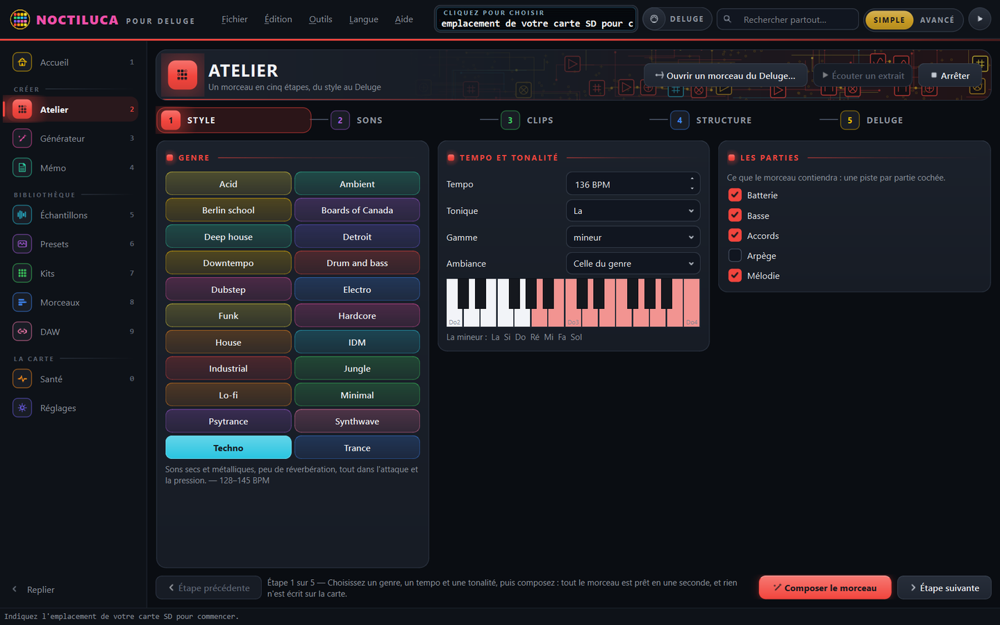
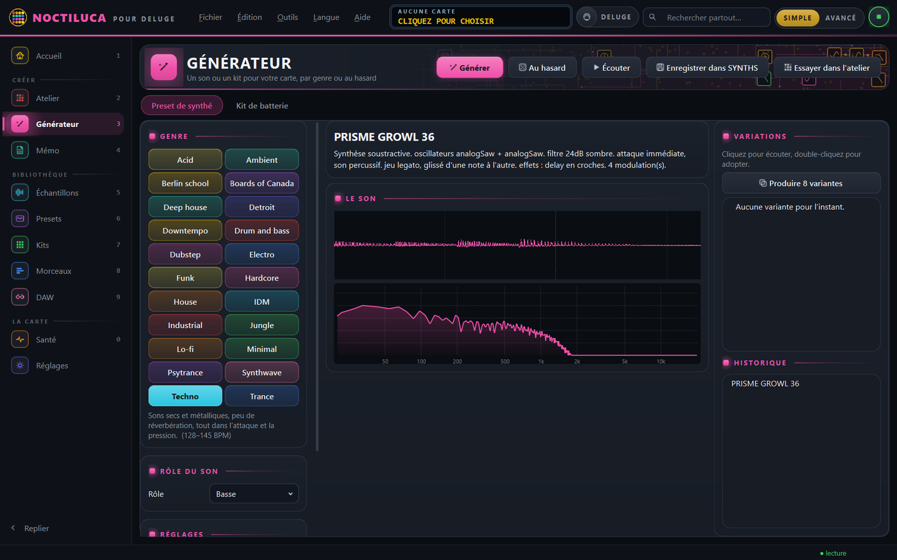
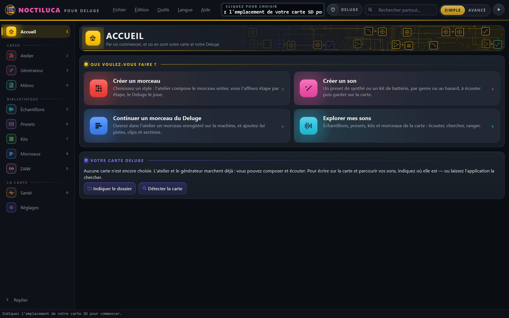
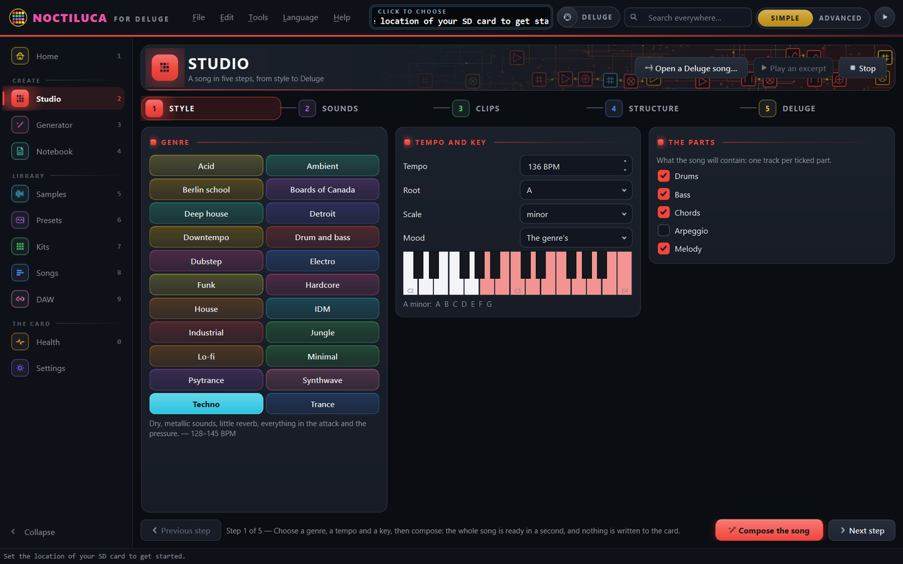
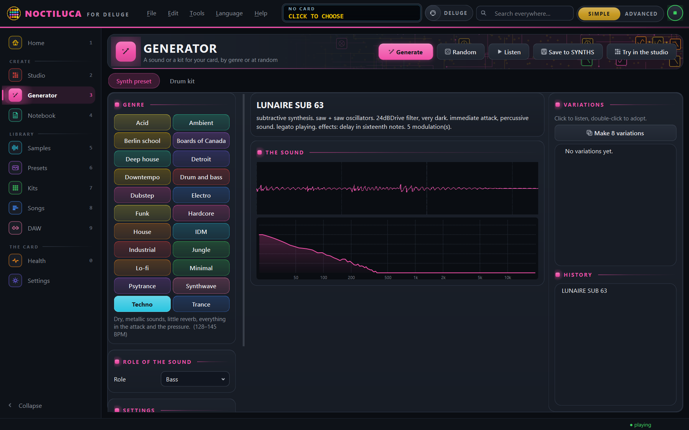

<p align="center"></p>

<h1 align="center">Noctiluca</h1>

<p align="center">
  <b>Le compagnon de bureau du Synthstrom Deluge</b> : carte SD, création de sons, composition.<br>
  <i>A desktop companion for the Synthstrom Deluge: SD card, sound design, composition.</i>
</p>

<p align="center">
  <a href="https://github.com/Blackminou29/noctiluca/releases/latest"><b>Télécharger · Download</b></a>
  &nbsp;·&nbsp; <a href="#english">English</a>
  &nbsp;·&nbsp; <a href="https://ko-fi.com/frenchfries29">Soutenir · Support ☕</a>
</p>



Application de bureau qui accompagne un **Synthstrom Deluge** : elle gère le
contenu de la carte SD, range les échantillons et les presets, répare les
références cassées, génère des presets de synthé et des kits, compose avec
vous un morceau du premier son à l'arrangement, et réunit les outils utiles
au quotidien d'un producteur de musique électronique.

Tout tient sur votre ordinateur : pas de serveur, pas de compte, pas d'accès
réseau. L'application lit la carte montée par un lecteur SD ou par l'USB du
Deluge, et ne l'écrit jamais sans montrer d'abord ce qu'elle va faire.

## Télécharger

Gratuit, sans compte et sans publicité : prenez le fichier de votre système
dans la page [**Releases**](https://github.com/Blackminou29/noctiluca/releases/latest).

| Système | Fichier |
|---|---|
| Windows 10 ou 11, 64 bits | `Noctiluca-…-windows-x64-setup.exe` : lancez-le, l'installateur fait le reste |
| macOS, Mac à puce Apple | `Noctiluca-…-macos-arm64.dmg` : glissez Noctiluca dans Applications |
| Linux x86_64 | `Noctiluca-…-linux-x86_64.AppImage` : rendez-le exécutable, puis lancez-le |

* **Le lien avec le Deluge branché** (écran recopié, carte lue par le câble,
  jeu en direct) **n'existe que sous Windows**. Sous macOS et Linux, la carte
  se lit avec un lecteur de cartes.
* Les paquets ne sont pas signés. Au premier lancement, Windows peut afficher
  « Windows a protégé votre ordinateur » : *Informations complémentaires ▸
  Exécuter quand même*. macOS peut refuser d'ouvrir l'application : *Réglages
  Système ▸ Confidentialité et sécurité ▸ Ouvrir quand même*.
* Sous Linux, l'écoute des sons demande le paquet `libportaudio2`.

## Soutenir le projet

Noctiluca est gratuit, et le restera. S'il vous fait gagner du temps ou vous
donne envie de rallumer votre Deluge, vous pouvez offrir un café à son auteur :
c'est ce qui finance les soirées passées à le faire grandir.

<p align="center">
  <a href="https://ko-fi.com/frenchfries29"></a>
</p>

| Créer un son | Par où commencer |
|---|---|
|  |  |

<a id="english"></a>

## In English

Noctiluca is a free desktop application for the **Synthstrom Deluge**. It
manages the SD card (samples, presets, kits, songs), repairs broken
references, generates synth presets and drum kits by genre, composes a whole
song with you in five steps and sends it to the Deluge, and bridges the Deluge
with your DAW. Nothing leaves your computer, and nothing is written to the card
without showing you the plan first.

**Download** the file for your system from the
[Releases page](https://github.com/Blackminou29/noctiluca/releases/latest):
the Windows installer, the macOS disk image (Apple silicon) or the Linux
AppImage. The interface starts in English; it is also available in French
(**Language ▸ Français**), and the choice is kept. The live link with a connected Deluge (screen mirror,
card over USB, live play) is Windows-only; on macOS and Linux, read the card
with a card reader. The packages are not signed: on first launch, Windows may
show "Windows protected your PC" (*More info ▸ Run anyway*), and macOS may
block the app until you allow it in *System Settings ▸ Privacy & Security*.

**Support**: Noctiluca is free and will stay free. If it helps you, you can
[buy its author a coffee on Ko-fi](https://ko-fi.com/frenchfries29).

| Studio | Generator |
|---|---|
|  |  |

## Licence

Noctiluca est un logiciel libre, distribué sous la
[licence publique générale GNU, version 3](LICENSE) (GPL v3) : vous pouvez
l'utiliser, l'étudier, le modifier et le redistribuer, sous la même licence.
Son moteur d'écoute reprend des tables et des algorithmes du
[firmware du Deluge](https://github.com/SynthstromAudible/DelugeFirmware),
lui aussi sous GPL v3. « Deluge » et « Synthstrom » sont des marques de
Synthstrom Audible Limited ; Noctiluca est un projet indépendant, ni affilié à
Synthstrom Audible ni approuvé par elle.

*Noctiluca is free software under the GNU GPL v3. "Deluge" and "Synthstrom"
are trademarks of Synthstrom Audible Limited; Noctiluca is an independent
project, neither affiliated with nor endorsed by Synthstrom Audible.*

---

Ce qui suit est la documentation détaillée : installation depuis les sources,
fonctionnement de chaque page, organisation du code.

---

## Installation

Pour les utilisateurs, Noctiluca se distribue tout prêt, sans Python : un
installateur pour Windows, une image disque pour macOS, une AppImage pour
Linux. Les construire : [`packaging/LISEZMOI.md`](packaging/LISEZMOI.md)
(sous Windows, `powershell -ExecutionPolicy Bypass -File
packaging\construire-windows.ps1`).

Depuis les sources : Python **3.11 ou plus récent** (développé sur 3.13).

```bash
pip install -r requirements.txt
python main.py
```

Deux paquets sont nécessaires — **PyQt6** pour l'interface et **numpy** pour
tout ce qui touche à l'audio. **numba** est recommandé : il compile le moteur
d'écoute, dix fois plus rapide ; sans lui, tout fonctionne, au même son, plus
lentement. **sounddevice** est optionnel : sans lui, l'application démarre
normalement, mais les boutons d'écoute restent inactifs.

Une seule fenêtre à la fois : relancer l'application ramène celle qui est
déjà ouverte — deux fenêtres se disputeraient le Deluge branché.

### Options de ligne de commande

| Option | Effet |
| --- | --- |
| `--sd CHEMIN` | utilise cette carte pour cette session, et la mémorise |
| `--reset-db` | vide l'index avant de démarrer |
| `--no-splash` | pas d'écran de démarrage |
| `--verbose` | journal détaillé sur la console |
| `--version` | affiche la version et quitte |
| `--self-test [RAPPORT]` | vérifie l'application installée, sans toucher aux réglages, et quitte (0 : en ordre) ; absente de `--help` |

Réglages, index et journal vivent dans `%APPDATA%\Noctiluca\` sous
Windows, `~/.config/Noctiluca/` ailleurs : `settings.json`,
`library.db`, `app.log`.

La variable d'environnement **`NOCTILUCA_CONFIG`** déplace ce dossier.
De quoi emporter le logiciel et ses réglages sur une clé USB :

```bash
NOCTILUCA_CONFIG=/media/cle/noctiluca python main.py
```

L'application s'appelait **Deluge Companion** jusqu'au 5 novembre 2026. À son
premier lancement sous le nouveau nom, elle renomme ses dossiers
`DelugeCompanion` (réglages, index, copie de travail), sans rien copier, et
reprend l'état de sa fenêtre ; l'ancienne variable `DELUGE_COMPANION_CONFIG`
vaut toujours.

---

## Premier démarrage

**L'application s'ouvre même sans carte.** Si aucune carte n'est connue, elle
ouvre la page *Réglages*, et l'écran de la barre du haut affiche « AUCUNE
CARTE — CLIQUEZ POUR CHOISIR ». Le chemin de la carte se change à tout moment, dans *Réglages* ou
par `Ctrl+O` : il n'est écrit nulle part dans le code. Les cartes utilisées
récemment sont proposées, et les lecteurs branchés sont repérés tout seuls :
est reconnu comme carte Deluge tout emplacement portant au moins deux des
dossiers `SONGS/`, `SYNTHS/`, `KITS/`, `SAMPLES/`.

Ensuite, **Analyser la carte** (`Ctrl+R`) remplit l'index. L'analyse est
incrémentale : les fichiers inchangés ne sont pas relus, et elle s'interrompt
sans rien abîmer. Sur une carte de 1741 échantillons, le premier passage
prend quelques minutes avec l'analyse acoustique activée, puis les suivants
quelques secondes.

---

## Par où commencer

Au premier lancement, l'application demande où se trouve votre carte : soit
vous indiquez le dossier, soit vous la laissez **chercher toute seule** sur
les lecteurs branchés. Ensuite, **Analyser la carte** (`Ctrl+R`) remplit
l'index, et tout le reste s'allume.

À partir de là, l'**accueil** demande « Que voulez-vous faire ? » : créer un
morceau, créer un son, continuer un morceau du Deluge, explorer vos sons.
Dessous, un bandeau **« À faire maintenant »** donne une suggestion, la plus
utile sur le moment, avec le bouton qui l'exécute. Pas de sauvegarde ? Il le
dit avant de proposer autre chose. Des sons manquent à des presets ? Il mène
directement à l'écran qui les retrouve.

**Simple ou avancé.** Au premier démarrage, chaque page ne montre que
l'essentiel, de quoi créer sans se perdre. L'interrupteur « Simple | Avancé »
de la barre du haut (`Ctrl+E`) montre tout : graines, moteurs, accords un à
un, groove, rythmes euclidiens, exports MIDI, traitements de fichiers.

**Chaque commande s'explique** : laissez la souris dessus une seconde. Les
actions qui écrivent sur la carte le disent avant d'être cliquées.

**Le manuel** est dans le menu *Aide* : `F1` l'ouvre au chapitre de la page
affichée, *Premiers pas* sur un parcours guidé de dix minutes. Vingt-cinq
chapitres en six parties — prise en main, créer, la bibliothèque, la carte,
le Deluge branché, référence —, mis en page comme le *Guide du Deluge* : papier, Georgia,
encadrés, figures et ouvertures de partie au treillis. Il se lit en français
ou en anglais, se parcourt par son sommaire ou sa recherche (accents et
majuscules ignorés), ouvre d'un clic la page dont il parle, et s'enregistre en
PDF.

---

## Se repérer

L'interface reprend le *Guide du Deluge* : la façade sombre de la machine,
ses pads lumineux, son écran, et le treillis de circuits des ouvertures de
partie.

- **Chaque page a sa couleur**, prise dans les pads de la machine : ambre
  pour l'accueil, rouge pour l'atelier, magenta pour le générateur, menthe
  pour le mémo, cyan pour les échantillons, violet pour les presets, vert
  pour les kits, bleu pour les morceaux, orange pour la santé, indigo pour
  les réglages. Comme chaque partie du guide a la sienne, la page la
  porte partout : son pad allumé dans la colonne de gauche, le filet
  lumineux sous la barre du haut, l'en-tête et son treillis, le bouton
  principal, les sélections, les onglets, les cases et les curseurs.
- **La colonne de gauche est une rangée de pads**, dans l'ordre du travail :
  l'accueil, puis *Créer* (atelier, générateur, mémo), *Bibliothèque*
  (échantillons, presets, kits, morceaux, et le pont vers le DAW) et
  *La carte* (santé, réglages).
  Éteints, les pads montrent leur couleur en veilleuse ; celui de la page
  affichée s'allume. Le chiffre à droite est son raccourci (`Ctrl+1` à
  `Ctrl+9`, puis `Ctrl+0` pour la santé ; les réglages ont `Ctrl+,`), et
  `Ctrl+B` réduit la colonne à ses pads.
- **L'écran en haut** est celui du Deluge : la carte ouverte et ce qu'elle
  contient. Chaque message de l'application y passe quelques secondes, et
  défile s'il est trop long, comme sur la machine. Un clic mène aux réglages
  de la carte.
- **La pastille « Deluge »** s'allume en or quand la machine est branchée, en
  vert quand elle est connectée ; verte, un clic ouvre *Deluge en direct*.

Un raccourci montre la couleur de **sa destination** — sur l'accueil, la
porte « Créer un son » est magenta parce qu'elle mène au générateur, et le
bouton « Sauvegarder » du bandeau est orange parce qu'il mène à la page
*Santé*, **directement sur l'onglet des sauvegardes**.

Un bouton éteint attend quelque chose de vous : la plupart du temps, une
ligne choisie dans la liste. Sur une fenêtre étroite, les boutons d'une page
se replient sur leur icône ; laissez la souris dessus pour lire leur nom.

La couleur choisie dans *Réglages → Apparence* est celle de la façade : la
barre du haut, les menus, et les fenêtres ouvertes hors des pages.

---

## Brancher le Deluge

Reliez le Deluge au PC en USB : la pastille **Deluge** de la barre du haut
passe au vert — l'application se connecte d'elle-même si la case en est
cochée dans *Réglages › Deluge branché* — et la machine dit sa version
(aller-retour de 0,3 ms).

### Sa carte reste dedans

Avec le **firmware 1.3**, le Deluge ouvre sa carte au PC par le câble USB.
L'application travaille alors sur une **copie de travail** qu'elle tient à
l'image de la carte : ce que vous créez part sur la carte, ce que vous
enregistrez sur le Deluge revient — à la connexion, après chaque écriture,
au retour dans la fenêtre, jamais pendant que la machine joue. Après une
écriture, seuls les dossiers touchés sont relus sur la carte : un morceau
part en quelques centièmes de seconde de plus que son transfert, au lieu des
3,5 s d'un parcours complet.
*Réglages › Carte du Deluge › Créer la copie de travail*, une fois : elle
reprend de votre sauvegarde ce qui y est déjà et ne fait passer par le câble
que le reste (une minute chez vous).

* changé des deux côtés : les deux versions sont gardées ;
* une suppression faite sur le PC ne part sur la carte **qu'avec votre
  accord** ; une suppression faite sur le Deluge part dans l'historique de
  la copie ;
* **votre sauvegarde n'est que lue**. Elle se met à jour sur commande
  (*Mettre à jour la sauvegarde*), sans que rien n'y soit jamais supprimé.

Avec le firmware 1.2.1, la carte ne s'ouvre que glissée dans un lecteur du
PC (*Réglages › Autre emplacement de carte*).

### Envoyer au Deluge, et retour

La carte restant dans la machine, l'Explorateur ne l'atteint plus : c'est
l'application qui y pose vos sons. **Glissez des fichiers ou un dossier
n'importe où sur la fenêtre** — un pack téléchargé, un bounce de votre
logiciel de MAO —, ou *Fichier › Envoyer des fichiers au Deluge* (Ctrl+I),
*Envoyer un dossier* (Ctrl+Maj+I), ou le bouton de la page *Échantillons*,
qui envoie dans le dossier choisi dans son arbre.

Le **plan** s'affiche avant toute copie : où va chaque fichier, ce qui est
déjà sur la carte, ce que le Deluge refuserait, et **combien de temps le
câble y mettra** — 60 Ko/s : un pack de 18 Mo, cinq minutes ; de 271 Mo,
près d'une heure vingt. Les fichiers partent ensuite en arrière-plan,
ou à la prochaine connexion du Deluge ; l'écran de la barre du haut dit
combien attendent (« 3 À ENVOYER »).

* un pack qui a la forme d'une carte (`SAMPLES`, `SYNTHS`…) garde ses chemins,
  que ses presets citent ; le reste va dans le dossier d'échantillons choisi ;
* **rien d'existant n'est remplacé** : identique, il est laissé ; homonyme,
  le nouveau est numéroté (« Kick 2.wav ») ;
* les noms deviennent lisibles par le câble (« Été » devient « Ete ») et
  les presets du pack suivent ;
* un fichier que le Deluge refuserait — un WAV à en-tête étendu, comme en
  écrivent beaucoup de logiciels de MAO — est converti sans perte audible ;
  un quatre-canaux, un MP3, restent sur le PC, et le plan dit pourquoi ;
* **pendant que le Deluge joue, rien ne passe** : un transfert s'arrête entre
  deux blocs et reprend à l'arrêt.

Dans l'autre sens, le panneau **Le Deluge et le PC** de l'accueil
liste ce qui est arrivé de la machine — un clic l'ouvre sur sa page —, et
un son de la page *Échantillons* **se glisse vers l'Explorateur ou votre
logiciel de MAO**. Quand la carte a reçu ce que votre sauvegarde n'a pas
encore, *À faire maintenant* propose de la mettre à jour. Chaque échange
s'écrit au journal, fichier par fichier.

| | |
|---|---|
| **Voir la machine** | *Deluge en direct* (Ctrl+D, ou un clic sur la pastille verte) recopie son écran au moment où il change |
| **Suivre son tempo** | l'horloge qu'elle envoie en jouant donne son tempo à l'atelier et à la calculatrice du mémo |
| **Lire le son sélectionné** | avec le retour MIDI Follow, ses réglages s'affichent quand vous changez d'instrument ou tournez un bouton |
| **Écouter pour de vrai** | les presets sonnent sur le Deluge, avec son moteur, au lieu de l'approximation calculée par l'ordinateur |
| **Régler à distance** | les paramètres de l'instrument sélectionné — 52 d'usine, 79 avec la table du firmware 1.3 —, par le mode MIDI Follow du firmware communautaire |
| **Envoyer un motif** | le motif d'essai d'un kit part en mesure, avec l'horloge MIDI |
| **Tout éteindre** | un bouton de secours qui relâche toutes les notes, sur tous les canaux |

**Une fois, sur le Deluge** (SHIFT + SELECT) : MIDI ▸ MIDI-Follow ▸ Channel
▸ **Channel A** = le canal de l'application (1 par défaut) — sans ce réglage,
la machine ignore ce que l'application lui joue —, puis MIDI-Follow ▸
Feedback ▸ **Channel** = A, pour que le son sélectionné revienne à
l'application. L'horloge, elle, sort d'elle-même (MIDI ▸ Clock ▸ Output,
actif d'usine). Ces chemins valent en 1.2.1 comme en 1.3 (`gui/ui/menus.cpp`
du firmware de la machine). La fenêtre *Deluge en direct* coche ces réglages
dès l'ouverture : la 1.3 les écrit dans `SETTINGS/MIDIFollow.XML`.

Trois choses à savoir :

* **le Deluge joue l'instrument sélectionné sur lui.** Aucun message MIDI ne
  permet de lui dire « charge ce preset » ; c'est une limite de la machine ;
* l'écoute sur le Deluge ne s'active pas toute seule. Elle se coche dans
  *Réglages › Deluge branché* : envoyer du son dans une machine reliée à un
  ampli ne doit pas être une surprise ;
* **se connecter ne joue rien.** L'application demande à la machine sa
  version, mesure l'aller-retour et lui demande si sa carte s'ouvre par
  USB — des messages de lecture —, rien d'autre. Avec le firmware c1.2.1,
  les fichiers passent par une carte glissée dans le PC : il ne les ouvre
  pas en USB.

La correspondance des contrôleurs est lue dans `SETTINGS/MIDIFollow.XML` en
firmware 1.3, à la racine de la carte avant ; sans ce fichier, ce sont les
assignations d'usine, et la page *Réglages* le dit.

Au repos, le firmware 1.3 lance un **économiseur d'écran** : la recopie le
montre tel quel (des traits qui tombent, en mode « Deluge »), et le message
de « Faire signe » reste dessous. Seul un geste sur la machine le réveille
(Settings ▸ Defaults ▸ Screensaver pour le régler).

---

## Les onze pages

| Page | Raccourci | À quoi elle sert |
| --- | --- | --- |
| **Accueil** | `Ctrl+1` | par où commencer — créer un morceau, un son, continuer un morceau du Deluge, explorer — et l'état de la carte et de la machine |
| **Atelier** | `Ctrl+2` | composer un morceau en cinq étapes — style, sons, clips, structure, Deluge — puis l'écrire, le jouer sur le Deluge, ou compléter un des vôtres |
| **Générateur** | `Ctrl+3` | créer des presets de synthé et des kits : par **genre musical** ou au hasard, avec écoute avant d'écrire, et les essayer aussitôt dans le morceau |
| **Mémo** | `Ctrl+4` | gammes et accords, calculatrice de tempo et de mémoire, mixage harmonique, aide-mémoire du Deluge |
| **Échantillons** | `Ctrl+5` | parcourir, écouter, filtrer les 1700+ échantillons ; tempo, tonalité et catégorie détectés ; étiquettes et notes ; **traitement par lot** (mono, normalisation, rééchantillonnage, fondus) |
| **Presets** | `Ctrl+6` | inspecter les presets de synthé : oscillateurs, filtre, enveloppes, modulations, échantillons employés ; les utiliser dans l'atelier |
| **Kits** | `Ctrl+7` | voir les kits pad par pad, repérer les pads muets ou cassés ; les utiliser dans l'atelier |
| **Morceaux** | `Ctrl+8` | tempo, gamme, pistes et instruments de chaque morceau (**lecture seule**) ; l'écouter, clip par clip ou en entier ; l'ouvrir dans l'atelier ; export MIDI et rassemblement des dépendances |
| **DAW** | `Ctrl+9` | le pont avec votre logiciel de musique, au choix : un morceau **vers le DAW** (set Ableton Live, MIDI, DAWproject, Reaper, pistes audio), un projet **depuis le DAW** (MIDI, set Ableton Live, DAWproject, Reaper) en nouveau morceau, ou **jouer ensemble** — le DAW joue les sons du Deluge, chaque piste sur son canal |
| **Santé** | `Ctrl+0` | diagnostic complet, réparation guidée, rangement, sauvegarde |
| **Réglages** | `Ctrl+,` | carte SD, audio, analyse, niveau de l'interface, apparence, sauvegardes |

Autres raccourcis : `Ctrl+N` nouveau morceau, `Ctrl+E` mode avancé, `Ctrl+R`
analyser, `Ctrl+F` rechercher, `Ctrl+G` générateur, `Ctrl+O` choisir la
carte, `Ctrl+B` replier la barre latérale, `Ctrl+,` réglages, `Espace`
écouter, `F1` le manuel, `Ctrl+Q` quitter. La
liste complète est dans *Aide › Raccourcis clavier*.

---

## La règle qui ne se négocie pas

Une carte SD de Deluge contient des mois de travail. Le programme est donc
construit autour d'un principe simple : **il ne modifie rien sans qu'on le
lui demande explicitement.**

* Tout rangement, toute réparation, toute suppression est d'abord **simulé**.
  Le plan s'affiche opération par opération ; rien n'est touché avant un clic
  de confirmation (`apply=False` par défaut dans tout le cœur du programme).
* Chaque fichier XML réécrit laisse un **`.bak` horodaté** à côté de lui.
* Un doublon n'est **jamais** proposé à la suppression sur la foi d'une
  empreinte partielle : les candidats sont confirmés octet par octet avant
  d'apparaître.
* Les **morceaux ne sont jamais réécrits.** Le format est trop riche pour
  qu'une relecture-réécriture soit sûre ; la page *Morceaux* est donc
  volontairement en lecture seule.
* Le **dialecte XML d'origine est conservé** : un fichier du firmware 2.x est
  réécrit en 2.x, un fichier 3.0+ en 3.0+. Le Deluge continue de les lire.
* La sauvegarde se fait avant les opérations risquées, et se restaure.

---

## Ce que la page *Santé* sait trouver

Vingt-deux diagnostics, dont les plus utiles en pratique :

* **échantillons manquants** — un preset cherche un fichier qui n'est plus là.
  L'application propose un remplaçant par nom, taille et empreinte, puis
  recolle toutes les références en une seule passe ;
* **échantillons orphelins** — présents sur la carte, employés par rien ;
* **doublons confirmés** ;
* **noms incompatibles FAT32**, trop longs, ou contenant des caractères que
  le Deluge n'affiche pas ;
* **pads muets** dans un kit, oscillateurs silencieux dans un preset ;
* **XML réellement corrompu**, distingué des anomalies bénignes : un fichier
  à plusieurs racines est normal en firmware 2.x et n'est pas signalé ;
* **anomalies audio** : écrêtage, composante continue, silence, fréquences
  d'échantillonnage inhabituelles, batterie en stéréo ;
* **fichiers parasites** — `.DS_Store`, `._*`, `Thumbs.db`, corbeilles.

Une note sur 100 résume l'ensemble, et la réparation automatique traite les
codes dans un ordre sûr.

### Corriger, pas seulement signaler

Quatre de ces défauts se corrigent directement : **percussions en stéréo**
passées en mono, **fréquences inhabituelles** ramenées à 44,1 kHz,
**composante continue** retirée, **marge rendue** aux fichiers écrêtés. La
même mécanique sert au traitement par lot de la page *Échantillons*, avec en
plus la coupe du silence et les fondus.

Trois précautions, qui viennent de mesures sur une vraie carte :

* les presets bornent souvent leur échantillon **en nombre de trames**. Si un
  traitement change la longueur du fichier — rééchantillonnage, coupe du
  silence — ces bornes sont **remises à l'échelle** dans la même opération ;
* un **morceau** borne aussi ses échantillons en trames, et l'application ne
  réécrit jamais un morceau. Les fichiers qu'un morceau utilise sont donc
  **écartés** des traitements qui changent leur longueur, avec le motif
  affiché ;
* l'**écrêtage ne se répare pas.** Baisser le niveau rend de la marge pour le
  mixage ; les sommets rabotés à l'enregistrement ne reviennent pas.

Chaque fichier réécrit laisse son original dans
`_BACKUP/samplefix-<date>/`, d'où `samplefix.restore` le remet en place à
l'octet près — aucun bouton de l'interface ne l'appelle encore.

---

## Découper une boucle en kit

Un break, une boucle de batterie, une phrase : le bouton **Découper…** de la
page *Échantillons* en fait un kit où chaque pad joue une tranche.

Les coupes se placent **sur les attaques** détectées — avec un réglage de
sensibilité, et un alignement optionnel sur le tempo pour qu'un break rejoué
reste en place — ou **en divisions égales**, ce qui suffit sur une boucle
correctement coupée : 4 secondes à 120 BPM donnent 16 tranches de 250 ms, soit
la croche juste. Les coupes s'affichent sur la forme d'onde, numérotées, et un
clic écoute la tranche visée.

**Aucun fichier audio n'est dupliqué.** Les rangées du kit pointent toutes le
même échantillon, chacune avec ses propres bornes — exactement comme le font
déjà certains kits de la carte. Un export en fichiers séparés est proposé pour
qui veut des échantillons autonomes, mais il n'apporte rien au Deluge et
occupe le double de place.

---

## Un instrument depuis un dossier de notes

Un piano échantillonné note par note ne joue rien tant qu'aucun preset ne le
porte. **Créer un instrument…**, sur la page *Échantillons*, en fait un preset
**multi-échantillon** : une tranche du clavier par son, jusqu'à mi-chemin du
suivant, comme le Deluge le ferait. La hauteur vient du **nom** du fichier
(« A1 », « Db4 », « (C#3)_61 ») — la convention d'octave tranchée à l'écoute —,
sinon du fichier ou de l'écoute ; une couche de vélocité (« A1-97-127 »)
devient un preset à part. Comparé à un preset fait par la machine, les tranches
sont identiques sur 14 sons sur 16.

En mode avancé, **Table d'onde…** tire d'un son tenu une table pour le moteur
WAVETABLE du Deluge (64 cycles de 2 048 points) ; le Générateur s'en sert
ensuite. Et **Sur un pad du Deluge** pose un son parmi les favoris du
navigateur de la machine — ceux qu'on y pose reviennent en favoris dans
l'application.

---

## Retrouver un son par ressemblance

Sur 1 700 échantillons, le nom et le dossier ne suffisent plus. Sélectionnez
un son, cliquez **Sons proches**, et la liste ne montre plus que ce qui lui
ressemble, du plus proche au plus lointain, avec un pourcentage de proximité.

La comparaison porte sur huit mesures faites pendant l'analyse : brillance,
contenu grave et aigu, étalement du spectre, caractère bruité, rapport
crête/RMS et temps d'attaque. Les fréquences et les durées sont comparées en
rapports, pas en écarts — l'oreille entend un octave, pas un nombre de hertz.

Les voisins sont souvent d'un autre dossier, et c'est normal : un kick trouve
des toms, une caisse claire trouve des rim et des cowbells. C'est ce qui se
ressemble à l'oreille, pas ce qui est rangé ensemble.

Cette recherche demande que l'**analyse acoustique** ait tourné (une case dans
*Réglages*). Elle allonge la première analyse d'une carte — comptez trois
minutes pour 1 700 échantillons au lieu d'une — puis les analyses suivantes ne
relisent que ce qui a changé. L'analyse acoustique tourne sur plusieurs fils :
une carte de 1 750 sons se relit en entier en 47 s.

---

## Sortir un morceau du Deluge

Deux boutons sur la page *Morceaux*, qui n'écrivent jamais sur la carte :

**Morceau en MIDI** produit un fichier MIDI multipiste, une piste par clip,
les clips de batterie sur le canal des percussions. Toutes les pistes
démarrent au début : les clips du Deluge sont des boucles de la grille de
session, et le fichier ne dit pas à quel moment chacune se déclenche. Pour un
clip seul, le bouton *Clip en MIDI* existe toujours.

**Rassembler…** copie dans un dossier le morceau, les presets qu'il nomme et
les échantillons que ces presets lisent — avec l'arborescence d'origine. Le
dossier obtenu a la forme d'une carte : le recopier à la racine d'une autre
suffit à y jouer le morceau. De quoi archiver un morceau ou le donner sans
rien oublier. La liste complète s'affiche avant la première copie, et ce qui
manquerait est signalé.

---

## Écrire un morceau pour le Deluge

L'atelier écrit les **morceaux du Deluge** : un fichier neuf dans `SONGS`,
que la machine charge comme les autres, avec ses instruments, ses clips, ses
sections et l'arrangement. Les autres pages y mènent : le générateur
(*Essayer dans l'atelier*), les presets et les kits (*Utiliser dans
l'atelier*) donnent leur son au morceau en cours — ou au prochain —, et la
page *Morceaux* ouvre un morceau dans l'atelier.

| Où | Bouton | Ce que contient le morceau |
|---|---|---|
| Atelier › Deluge | **Écrire le morceau** | le morceau composé : une section du Deluge par section, leurs clips, leurs répétitions et l'arrangement |
| Atelier › Deluge | **Compléter le morceau** | votre morceau octet pour octet, plus les pistes, clips et sections ajoutés — dans une nouvelle version |
| Échantillons › Découper | **Écrire en morceau** | le kit des tranches et un clip qui rejoue la boucle |

Le nom est demandé, puis le plan s'affiche — fichier, instruments, clips,
échantillons absents — avant toute écriture. **Aucun fichier existant n'est
remplacé** : un nom déjà pris est numéroté.

Un morceau à sections se joue de deux façons : **PLAY** fait tourner l'intro en
boucle, et lancer la section suivante déroule toute la suite jusqu'à la fin ;
la vue arrangement joue le morceau entier d'un trait. Les parties qui se
répètent tiennent dans des clips courts — quatre mesures d'accords, une
mesure de batterie — comme on les construit sur la machine.

Le format est celui qu'écrit le firmware communautaire c1.2.1. Un kit ou un
preset ancien de la carte reçoit les conversions que la machine ferait en le
chargeant ; elles ont été comparées aux morceaux que vous avez enregistrés
sur la machine. **Éprouvé sur un Deluge en firmware 1.3** (22 octobre 2026) :
une progression avec sa batterie, une esquisse à six sections et un motif sur
le kit TR-808, envoyés par le câble, se chargent et jouent.

---

## Composer dans l'atelier

La page **Atelier** tient ensemble, autour d'**un morceau** et d'**un
style**, tout ce qui crée — du choix des sons à l'arrangement —, en **cinq
étapes** qu'une barre montre en haut de la page et que *Étape précédente* et
*Étape suivante* parcourent :

1. **Style** — un genre, une tonalité, un tempo, l'ambiance des accords (et,
   en mode avancé, les accords un à un et les six curseurs du générateur,
   communs à tous les synthés du morceau : c'est ce qui les fait sonner
   ensemble). *Composer le morceau* le fabrique en une seconde. Chaque partie — batterie, basse,
   accords, arpège, mélodie — joue sur un kit, un synthé du Deluge, une
   **piste MIDI** vers un appareil extérieur ou une **piste CV** vers un
   modulaire.
2. **Sons** — un son par piste, et **huit variantes dans le style** : chacune
   ne retire qu'un aspect (le filtre, les enveloppes, l'espace…) ou ne pousse
   qu'un curseur (plus brillant, plus sale…). Plus sale, c'est le même son en
   plus sale, pas un autre son. **Modifier le son…** ouvre l'éditeur :
   oscillateurs, filtres, enveloppes, LFO, effets et modulations, chaque
   réglage au cran de la machine et, dessous, ce qu'il vaut sur le Deluge
   (« decay 13 · 1,8 s »). Le même éditeur s'ouvre depuis le Générateur.
3. **Clips** — un premier clip par piste, puis ses **variations** : rythme
   décalé, autres notes, plus ou moins de notes, réponse, octave, fin de
   phrase ; pour la batterie, ornements, roulement, cassure, demi-temps,
   montée. Toujours dans la gamme, toujours parentes de l'original. La
   batterie **se dessine au clic**, les notes d'un synthé aussi ; en mode
   avancé, groove, rythmes euclidiens et style de jeu des accords et de la
   basse.
4. **Structure** — une grille pistes × sections, la structure du genre en un
   clic.
5. **Deluge** — **Écrire le morceau** : un morceau neuf, sections et
   arrangement compris, qui part sur la machine par le câble.

**Travailler en même temps que la machine.** *Jouer sur le Deluge* envoie un
clip à la machine, dans le clip que suit MIDI Follow, calé sur sa mesure —
en enregistrement, il s'y inscrit. *Ouvrir un morceau du Deluge…* ouvre un de vos
morceaux (les derniers reçus du Deluge en tête) ; *Compléter le morceau* en
écrit une **nouvelle version** (« Cool1 5 » après « Cool1 4 ») qui le
contient **octet pour octet**, plus vos pistes, vos clips et vos sections :
le fichier est relu et la preuve refaite avant d'écrire, et l'original n'est
jamais touché.

**Rien ne se perd.** *Défaire* et *Refaire* (Ctrl+Z, Ctrl+Y) remontent chaque
geste, jusqu'à un morceau recomposé ; les sons qu'« Autre son » a remplacés
restent dans la liste des **sons essayés** ; le morceau en cours est gardé sur
l'ordinateur et revient au lancement suivant. Une version écrite par l'atelier
et restée telle quelle peut être **remplacée** au lieu d'être numérotée — à
votre demande, l'ancienne gardée dans `_BACKUP`.

---

## Génération de presets

Le générateur part d'un **profil de genre** — 22 sont fournis, de la techno
de Détroit à la jungle, du dubstep au synthwave — et en tire des presets
cohérents : forme d'onde, désaccord, filtre, enveloppes, LFO, modulations,
effets. Chaque profil porte ses plages de tempo, ses gammes favorites et dix
rôles : basse, lead, nappe, pincé, clavier, accord bref, effet, bourdon,
arpège, cloche.

Deux garanties utiles :

* un preset généré **fait du son** — un oscillateur muet, un filtre fermé,
  une enveloppe sans attaque ni tenue sont rattrapés avant l'écriture ;
* l'**écoute est hors-ligne** : le preset est rendu par le moteur interne
  (`core/render.py`) et joué sur l'ordinateur, sans passer par le Deluge —
  en **refaisant les calculs du firmware** de la machine : les lois des
  réglages (`core/paramlaws.py`) et le traitement du signal (`core/dsp.py`),
  formes d'onde, filtres en échelle, saturation, FM, effets et
  réverbération, vérifiés contre des transcriptions entières de son code.
  Le sidechain — la grosse caisse qui fait pomper les autres sons et la
  réverbération —, le LFO 1 global et le glissé en fréquence y sont depuis
  le 8 novembre 2026. Restent approchés l'étirement des échantillons, le
  SVF, le « tape warble » et le balayage d'une table d'onde, dont aucun son
  de la carte ne se sert.

La même mécanique produit des kits de batterie complets, en choisissant parmi
les échantillons de la carte ceux qui correspondent aux rôles du genre.

---

## Organisation du code

```
main.py                  lancement, journal, écran de démarrage, garde-fous
packaging/               installateur Windows, image macOS, AppImage Linux
delugeapp/
  config.py              réglages persistants et contexte applicatif
  autotest.py            --self-test : un paquet construit vérifié de l'intérieur
  docs/                  le texte du manuel, manuel.fr.md et manuel.en.md
  core/                  tout le métier, sans aucune dépendance à Qt
    sdcard.py            seule porte vers la carte (FAT32 insensible à la casse)
    dxml.py              lecture et écriture tolérantes du XML Deluge
    model.py             sons, presets, kits, morceaux
    fixedpoint.py        entiers 32 bits du Deluge <-> valeurs lisibles
    wav.py analysis.py   audio : lecture, tempo, tonalité, catégorie
    db.py scan.py        index SQLite et analyse incrémentale
    deps.py organize.py  dépendances entre fichiers, plans de rangement
    health.py backup.py  diagnostic, réparation, sauvegarde
    genres.py synthgen.py kitgen.py   génération
    theory.py rhythm.py midifile.py   théorie, rythme, export MIDI
    songwriter.py        écriture de morceaux du Deluge depuis les outils
    variation.py         variations d'un clip, dans la gamme et parentes
    atelier.py           le projet de l'atelier : style, pistes, clips, sections
    songinsert.py        compléter un morceau sans le réécrire, preuve à l'appui
    midiport.py          MIDI et SysEx par winmm, sans dépendance
    midifollow.py        les 52 contrôleurs du mode MIDI Follow
    delugelink.py delugesysex.py      le lien vivant avec la machine
    delugefiles.py cardsync.py        la carte par USB, la copie de travail
    cardimport.py        envoyer au Deluge : du PC vers la carte
    render.py audio_out.py            moteur d'écoute et sortie audio
    paramlaws.py         les lois des réglages du Deluge, lues dans son firmware
    dsp.py               son traitement du signal, porté (tables : data/)
    soundedit.py         les réglages d'un son, modifiables à la main
    multisample.py       un instrument multi-échantillon depuis un dossier
    wavetable.py         des tables d'onde pour le moteur WAVETABLE
    favourites.py        les favoris du navigateur de la machine
    updates.py           une version plus récente ? (seulement sur demande)
    firmware.py          préparer la carte pour un nouveau firmware (sans flasher)
  ui/
    mainwindow.py        assemblage des dix pages
    theme.py icons.py    identité graphique, icônes dessinées à la main
    art.py               treillis de circuits et pads du guide, au QPainter
    tasks.py             travaux longs hors du fil de l'interface
    songexport.py        parcours commun des boutons « en morceau »
    report.py            signaler un problème : un rapport à relire
    firmwaredialog.py    Outils ▸ Firmware du Deluge…
    livewindow.py        « Deluge en direct » : écran, tempo, son sélectionné
    cardwork.py          la copie de travail tenue à l'image de la carte
    sendfiles.py         glisser-déposer, plan et copie vers le Deluge
    manuel.py            le manuel : lecture, mise en page du guide, fenêtre
    manuel_dessins.py    ses ouvertures de partie et ses figures, au QPainter
    pages/               une page par domaine
    widgets/             façade (écran, pads de navigation), potentiomètre,
                         enveloppe, forme d'onde, pads, piano…
tests/
  test_core.py           797 tests du cœur
  test_ui.py             464 tests d'interface, dont ceux du manuel
  test_i18n.py           30 tests de la traduction
  test_atelier.py        68 tests de l'atelier, des variations, de l'insertion et de l'éditeur de son
  deluge_simule.py       un Deluge simulé, qui répond comme la vraie machine
SPEC.md                  contrat d'architecture : formats, règles, budgets
```

`core/` ne connaît pas Qt : il s'utilise tel quel depuis un script. `ui/` ne
touche jamais la carte directement — il passe par `core/`, et tout travail
long part dans un fil séparé pour que la fenêtre reste vivante.

---

## Tests

```bash
python -m unittest discover -s tests
```

1 359 tests, exécutés sur une vraie carte montée en lecture, et sur des copies
jetables pour tout ce qui écrit. **Ils n'écrivent jamais dans vos réglages** :
chaque module de test déplace la configuration dans un dossier temporaire
avant d'importer quoi que ce soit, et un test vérifie que ce déplacement a
bien eu lieu. Les tests d'interface se sautent d'eux-mêmes
si PyQt6 est absent ; sans serveur graphique, `QT_QPA_PLATFORM=offscreen`
suffit. **Aucun ne touche au Deluge branché** : les ports MIDI sont masqués,
et la liaison s'éprouve face à un Deluge simulé qui répond comme la vraie
machine, mesurée.

Ils couvrent aussi les deux détails qui ont coûté le plus cher : l'échelle
d'un câble de modulation vaut la **moitié** de celle des autres paramètres
(`0x40000000`), et le tempo se calcule sur **24** ticks par noire — ce qui
donne bien 120,000 BPM pour `DEFAULT.XML` — alors que les notes, elles,
comptent `96 << inputTickMagnitude` ticks par mesure.

---

## Notes de format

Mesuré sur une carte réelle — 1741 échantillons, 911 presets, 43 kits,
46 morceaux — et consigné dans `SPEC.md` :

* **deux dialectes XML** cohabitent : `<type>saw</type>` en firmware 2.x,
  `type="saw"` à partir de 3.0 ;
* trois anomalies réelles doivent être tolérées à la lecture : documents à
  plusieurs racines, `&` non échappé, octets non-UTF-8 ;
* les paramètres sont des **entiers 32 bits signés** : `0x80000000` au
  minimum, `0x00000000` au milieu, `0x7FFFFFFF` au maximum, affichés de 0 à
  50 — sauf les câbles de modulation, pleine échelle `0x40000000`, affichés
  de −50 à +50 ;
* la grille des notes compte **`96 << inputTickMagnitude` ticks par
  mesure** : 192 dans un morceau 3.x, 384 dans un morceau c1.2.1, où
  `length=1536` fait donc 4 mesures (les 24 ticks par noire sont ceux de
  l'horloge, pour le tempo) ;
* une note tient en 22 caractères hexadécimaux :
  `position(8) durée(8) vélocité(2) relâché(2) condition(2)`.
